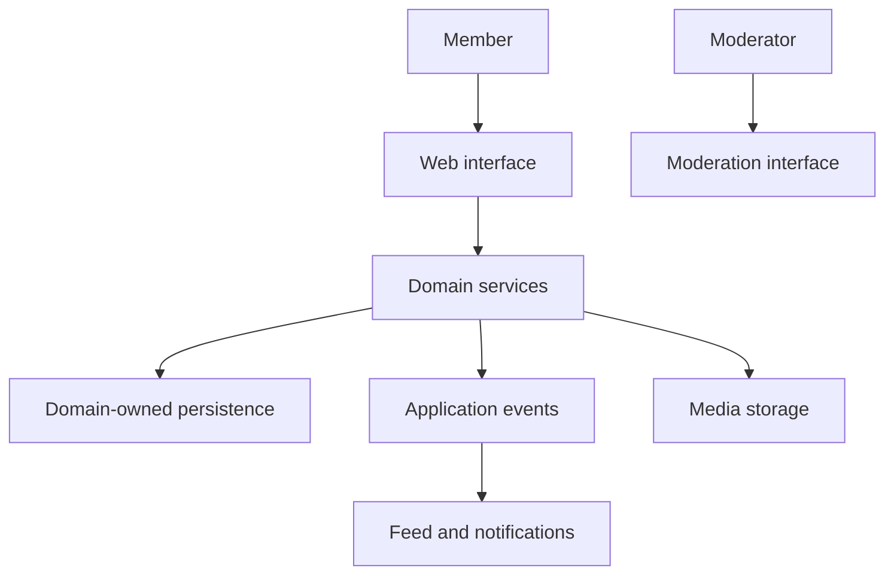

# Breezy — Social Networking Platform — Architecture

Users can build a profile, share posts, react and reply, follow other accounts and keep up with their network. The project explores domain-oriented backend services alongside a responsive web interface, including privacy, messaging and moderation concerns.

## Components

| Component | Responsibility |
|---|---|
| Web interface | Next.js, React and TypeScript screens for feed, profiles and interactions. |
| Domain services | Node.js/Express services for identity, users, posts, relationships, feed and notifications. |
| Media and moderation services | Dedicated responsibilities for uploaded media and report handling. |
| Domain persistence | PostgreSQL and MongoDB used by the corresponding application domains. |
| Event infrastructure | Shared contracts and RabbitMQ-backed communication for asynchronous effects. |
| Object storage | MinIO-backed media storage independent of service processes. |

## Main interactions

## Responsibility boundaries

- Separate services by social-network responsibility. Identity, posts, relationships and moderation can evolve within clear boundaries.
- Use events for secondary effects. Social actions can trigger feed or notification updates without combining every concern in one request.
- Keep media outside service-local filesystems. Uploaded content survives replacement of an application process.

## Constraints

Privacy and moderation apply across several services; a visible interface control is not sufficient without the corresponding server-side check.

## Technology

Next.js, React, TypeScript, Node.js, Express, PostgreSQL, MongoDB, RabbitMQ, MinIO, Docker, Jest and Playwright.
